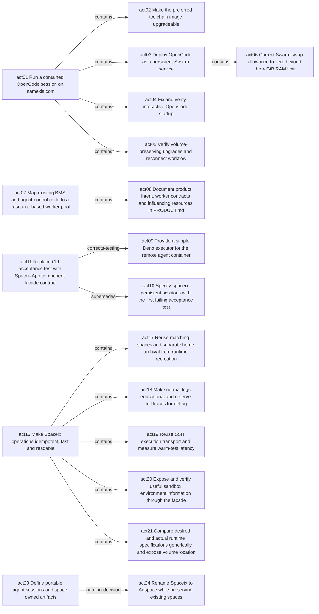

# Acts

- [x] `act01` Run a contained OpenCode session on namekis.com #status/closed
  - [x] `act05` Verify volume-preserving upgrades and reconnect workflow #status/closed
  - [x] `act04` Fix and verify interactive OpenCode startup #status/closed
  - [x] `act03` Deploy OpenCode as a persistent Swarm service #status/closed
    - [x] `act06` Correct Swarm swap allowance to zero beyond the 4 GiB RAM limit #status/closed
  - [x] `act02` Make the preferred toolchain image upgradeable #status/closed
- [ ] `act07` Map existing BMS and agent-control code to a resource-based worker pool #doing/actor01 #lease-start/1793556726 #lease-duration/PT1H #status/doing
  - [x] `act08` Document product intent, worker contracts and influencing resources in PRODUCT.md #status/closed
- [ ] `act09` Provide a simple Deno executor for the remote agent container #doing/actor01 #lease-start/1794124104 #lease-duration/PT1H #corrects-testing/act11/act09 #status/doing
- [x] `act10` Specify spaceix persistent sessions with the first failing acceptance test #supersedes/act11/act10 #status/closed
- [x] `act11` Replace CLI acceptance test with SpaceixApp component-facade contract #supersedes/act11/act10 #corrects-testing/act11/act09 #status/closed
- [x] `act12` Reuse tdd1 with force-archive-inplace during test setup #status/closed
- [x] `act13` Start SpaceixApp TDD with directory listing and installed tool versions #status/closed
- [x] `act14` Implement SpaceixApp and pass the first real sandbox toolchain scenario #status/closed
- [x] `act15` Log facade operations, executed scripts, output and timing in SpaceixApp #status/closed
- [x] `act16` Make Spaceix operations idempotent, fast and readable #status/closed
  - [x] `act21` Compare desired and actual runtime specifications generically and expose volume location #status/closed
  - [x] `act20` Expose and verify useful sandbox environment information through the facade #status/closed
  - [x] `act19` Reuse SSH execution transport and measure warm-test latency #status/closed
  - [x] `act18` Make normal logs educational and reserve full traces for debug #status/closed
  - [x] `act17` Reuse matching spaces and separate home archival from runtime recreation #status/closed
- [x] `act22` Strengthen install documentation, user-first writing and artifact verification practices #status/closed
- [ ] `act23` Define portable agent sessions and space-owned artifacts #naming-decision/act23/act24 #status/open
- [x] `act24` Rename Spaceix to Agspace while preserving existing spaces #naming-decision/act23/act24 #status/closed

## Authors
- actor01 Local/User #actor/actor01

## Events

### act03
- 2026-11-01T18:47:50+02 #actor/actor01 started duration="PT1H" expires-unix="1793555270"

### act06
- 2026-11-01T19:02:15+02 #actor/actor01 created title="Correct Swarm swap allowance to zero beyond the 4 GiB RAM limit"
- 2026-11-01T19:02:15+02 #actor/actor01 moved parent="act03"
- 2026-11-01T19:03:34+02 #actor/actor01 started duration="PT1H" expires-unix="1793556214"
- 2026-11-01T19:07:51+02 #actor/actor01 closed reason="Engine API set SwapBytes=0 after CLI ignored zero. Verified replacement task has RAM=SwapTotal=4294967296 and memory.swap.max=0; volume marker preserved."

### act07
- 2026-11-01T20:12:06+02 #actor/actor01 started duration="PT1H" expires-unix="1793560326"

### act08
- 2026-11-01T20:16:09+02 #actor/actor01 created title="Document product intent, worker contracts and influencing resources in PRODUCT.md"
- 2026-11-01T20:16:09+02 #actor/actor01 moved parent="act07"
- 2026-11-01T20:16:21+02 #actor/actor01 started duration="PT1H" expires-unix="1793560581"
- 2026-11-01T20:52:18+02 #actor/actor01 closed reason="Created and read back PRODUCT.md: resource-advertising pool intent, all user-provided influencing resources, inspected source entry points, proposed contracts, TDD scenarios and open architecture questions. Product definition stays in PRODUCT.md; progress stays in acts."

### act09
- 2026-11-08T09:48:24+02 #actor/actor01 started duration="PT1H" expires-unix="1794127704"

### act10
- 2026-11-08T15:10:24+02 #actor/actor01 started duration="PT1H" expires-unix="1794147024"

### act11
- 2026-11-08T15:24:47+02 #actor/actor01 edge-added label="corrects-testing" to="act09"

### act12
- 2026-11-08T15:27:37+02 #actor/actor01 created title="Reuse tdd1 with explicit in-place backup during test setup"
- 2026-11-08T15:27:58+02 #actor/actor01 updated title="Reuse tdd1 with force-archive-inplace during test setup"
- 2026-11-08T15:27:58+02 #actor/actor01 started duration="PT1H" expires-unix="1794148078"
- 2026-11-08T15:29:23+02 #actor/actor01 closed reason="Test now reuses tdd1 and begins with SpaceixApp.open(name, {on: host, forceArchiveInplace: true}). TDD.md defines archive-in-place preservation and failure semantics; AGENTS.md requires stable test identity. Expected RED remains missing SpaceixApp module; no remote execution."

### act13
- 2026-11-08T15:51:29+02 #actor/actor01 created title="Start SpaceixApp TDD with directory listing and installed tool versions"
- 2026-11-08T15:52:53+02 #actor/actor01 started duration="PT1H" expires-unix="1794149573"
- 2026-11-08T15:56:28+02 #actor/actor01 closed reason="First active facade scenario opens tdd1 with forceArchiveInplace, lists its directory and checks installed tool versions via app.exec structured results. Prior multi-client test retained with ignore:true; timed-output reconnect test deferred. TDD.md updated. Expected RED remains missing SpaceixApp module; no remote execution."

### act15
- 2026-11-08T16:12:59+02 #actor/actor01 created title="Log facade operations, executed scripts, output and timing in SpaceixApp"
- 2026-11-08T16:13:32+02 #actor/actor01 started duration="PT1H" expires-unix="1794150812"
- 2026-11-08T16:18:19+02 #actor/actor01 closed reason="Added default operation/SSH logs with correlation IDs, inputs, complete remote scripts, explicit /bin/sh and stdin state, live stdout/stderr, returned values, errors and durations. Facade test observes public log events and verifies returned results remain intact. Real-host test passed: 1 passed, 0 failed, 1 ignored. Transcript remote1.md shows open=10803ms, inspect=1059ms and exec calls 944–1545ms. Updated TDD.md and AGENTS.md."

### act17
- 2026-11-08T16:24:29+02 #actor/actor01 created title="Reuse matching spaces and separate home archival from runtime recreation"
- 2026-11-08T16:24:29+02 #actor/actor01 moved parent="act16"
- 2026-11-08T16:30:03+02 #actor/actor01 started duration="PT1H" expires-unix="1794151803"
- 2026-11-08T16:46:46+02 #actor/actor01 closed reason="Ordinary open/test now reuses matching Docker resources, home and tmux; specification mismatches fail rather than replace. forceArchiveInplace now targets files under the same home volume rather than Docker generations. Read-only reuse passed on real host; explicit home archival remains outside the active scenario and unexercised."

### act18
- 2026-11-08T16:24:29+02 #actor/actor01 created title="Make normal logs educational and reserve full traces for debug"
- 2026-11-08T16:24:29+02 #actor/actor01 moved parent="act16"
- 2026-11-08T16:46:29+02 #actor/actor01 started duration="PT1H" expires-unix="1794152789"
- 2026-11-08T16:46:46+02 #actor/actor01 closed reason="Default output now shows concrete prerequisites/matching values, reuse decisions, commands, output and timing. Full scripts and payloads require debug:true or APP_DEBUG; public structured events remain intact. Real facade scenario passed."

### act19
- 2026-11-08T16:24:29+02 #actor/actor01 created title="Reuse SSH execution transport and measure warm-test latency"
- 2026-11-08T16:24:29+02 #actor/actor01 moved parent="act16"
- 2026-11-08T16:46:29+02 #actor/actor01 started duration="PT1H" expires-unix="1794152789"
- 2026-11-08T16:46:46+02 #actor/actor01 closed reason="One SSH channel now performs open/bootstrap and remains ready for all exec requests; no second lazy connect. Real scenario passed in about 3–4 seconds versus about 20 seconds; most warmed commands 58–117ms. Transport remains private inside spaceix.ts."

### act20
- 2026-11-08T16:46:29+02 #actor/actor01 created title="Expose and verify useful sandbox environment information through the facade"
- 2026-11-08T16:46:29+02 #actor/actor01 moved parent="act16"
- 2026-11-08T16:46:46+02 #actor/actor01 started duration="PT1H" expires-unix="1794152806"
- 2026-11-08T17:03:49+02 #actor/actor01 closed reason="Implemented environment(connectionId) on the same SSH execution channel; real-host test passes and reports Alpine/kernel/architecture, agent UID/GID, actual tmux shell version, paths, terminal/locale and Docker volume mountpoint. Compilation green; 1 passed, 1 ignored in about 3–4 seconds."

### act21
- 2026-11-08T16:49:38+02 #actor/actor01 created title="Compare desired and actual runtime specifications generically and expose volume location"
- 2026-11-08T16:49:38+02 #actor/actor01 moved parent="act16"
- 2026-11-08T17:03:49+02 #actor/actor01 started duration="PT1H" expires-unix="1794153829"
- 2026-11-08T17:20:17+02 #actor/actor01 closed reason="One RUNTIME_SPEC now drives Swarm creation and generic recursive desired/actual comparison. environment() exposes the diff and real volume host mountpoint; duplicate path logging removed. Type-checking passed and the matching/reuse facade scenario passed on namekis.com in about four seconds (1 passed, 1 ignored). Cold creation and explicit archival require separate verification. User-facing guide updated; design/principles under Development and time-specific follow-ups under act16."

### act22
- 2026-11-08T17:43:24+02 #actor/actor01 created title="Strengthen install documentation, user-first writing and artifact verification practices"
- 2026-11-08T17:43:33+02 #actor/actor01 started duration="PT1H" expires-unix="1794156213"
- 2026-11-08T18:22:05+02 #actor/actor01 closed reason="Updated install documentation skill: missing release URL is not a blocker; retain all four command forms with explicit placeholders/readiness. Updated information-locality and useful-notes guidance for examples then public install then Development/Dev Usage, and added artifact-readback completion gate. Verified practices and applied the structure to the renamed agspace.md."

### act23
- 2026-11-08T18:00:27+02 #actor/actor01 created title="Define portable agent sessions and space-owned artifacts"
- 2026-11-08T18:21:09+02 #actor/actor01 edge-added label="naming-decision" to="act24"

### act24
- 2026-11-08T18:05:56+02 #actor/actor01 created title="Rename Spaceix to Agspace while preserving existing spaces"
- 2026-11-08T18:08:14+02 #actor/actor01 started duration="PT1H" expires-unix="1794157694"
- 2026-11-08T18:21:09+02 #actor/actor01 added content="act24-rename-spaceix-to-agspace-while-preserving-exist.md"
- 2026-11-08T18:22:05+02 #actor/actor01 closed reason="Renamed source, test, guide, facade and log-event type to Agspace; updated active docs and test env naming. Existing Spaceix metadata/resources/tmux are recognized without migration or recreation. Type check passed and renamed real-host facade test passed (1 passed, 1 ignored, about 4s), reusing the same tdd1 container and volume. Evidence: remote1.md."

## Graph

| Relation | From | To |
| --- | --- | --- |
| `contains` | `act01` | `act02` |
| `contains` | `act01` | `act03` |
| `contains` | `act01` | `act04` |
| `contains` | `act01` | `act05` |
| `contains` | `act03` | `act06` |
| `contains` | `act07` | `act08` |
| `contains` | `act16` | `act17` |
| `contains` | `act16` | `act18` |
| `contains` | `act16` | `act19` |
| `contains` | `act16` | `act20` |
| `contains` | `act16` | `act21` |
| `corrects-testing` | `act11` | `act09` |
| `naming-decision` | `act23` | `act24` |
| `supersedes` | `act11` | `act10` |

